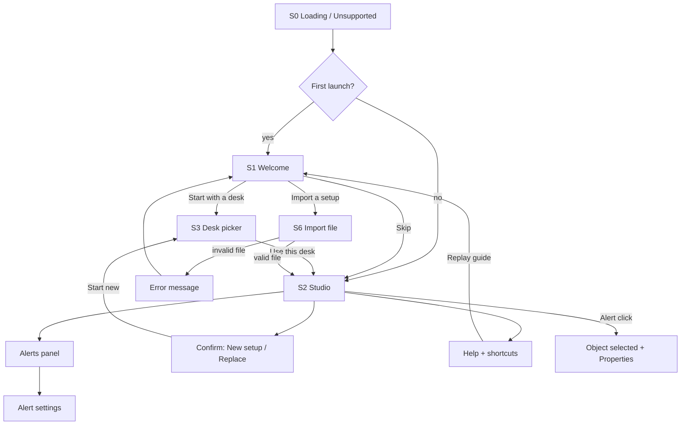

# Architecture de l'information et des écrans

## Principe : un seul écran de travail
Le MVP tient en **1 écran principal (le "Studio")** + quelques modales. L'utilisateur reste toujours devant sa scène : pas de navigation par pages. Moins d'écrans = moins de clics. Les fonctions futures ont des **emplacements réservés** (structure, pas de bouton grisé ni "coming soon" au MVP).

## Liste des écrans MVP (justification)
| # | Écran | Rôle | Justification |
|---|---|---|---|
| S0 | **Loading / unsupported** | Chargement, WebGL absent | Évite l'écran blanc ; cas d'erreur obligatoire |
| S1 | **Welcome** (modal, 1er lancement) | "Start with a desk", "Import a setup", guide 3 étapes | Prise en main sans notice [US-020] ; ignorable |
| S2 | **Studio** (écran principal) | Scène 3D + bibliothèque + propriétés + alertes + barre du haut | Tout le travail se fait ici |
| S3 | **Desk picker** (panneau gauche, onglet "Desk"; en modal au 1er lancement) | Choisir/changer le bureau, dimensions custom | Même composant réutilisé, pas d'écran dédié [US-006/007] |
| S4 | **Alerts panel** (zone du Studio) | Liste par gravité + indicateur global | Cœur de la valeur "ça rentre ?" [US-017] |
| S5 | **Confirm dialogs** (New setup, Replace on import, Delete désactivé car Ctrl+Z) | Actions destructives | Sécurité sans friction |
| S6 | **Import/Export** (menu "File" + sélecteur de fichier) | Export/import JSON | Pas d'écran : menu + dialogue système [US-018] |
| S7 | **Help** (modal : guide 3 étapes, raccourcis clavier) | Aide permanente | Rouvre le guide fermé [US-020] |

Pas d'écran de réglages au MVP : seuils d'alerte ajustables via un lien "Alert settings" dans le panneau Alerts (petite modale S8, **Alert settings** : occupation %, marge de profondeur, zone libre clavier). Rangé ici car les seuils sont "ajustables" (H5).

## Arborescence
```
App
├─ S0 Loading / Unsupported browser
├─ S1 Welcome (modal, premier lancement)
└─ S2 Studio
   ├─ Top bar
   │   ├─ Setup name (éditable) + "Saved in this browser"
   │   ├─ Undo / Redo
   │   ├─ File menu: New setup, Import setup, Export setup   [futur: Save as image, Share]
   │   ├─ Fit indicator: "It fits" / "Doesn't fit - N issues"
   │   └─ Help (S7)                                          [futur: Shopping list, Account]
   ├─ Left panel (tabs)
   │   ├─ Desk (S3): catalogue + "Custom size"
   │   ├─ Objects: 9 types ; recherche si > 12 items          [futur: Style, Ambience, Decor]
   │   └─ (onglets futurs insérés ici, au même niveau)
   ├─ Viewport 3D
   │   ├─ Floating toolbar (bas-centre): Reset view, Snap on/off, Rotate -15/+15, Duplicate, Delete (si sélection)
   │   └─                                                    [futur: Day/Night, View modes, AR]
   ├─ Right panel
   │   ├─ Properties (objet sélectionné ou bureau)            [futur: onglet Material]
   │   └─ Alerts (S4) + "Alert settings" (S8)
   └─ Dialogs: S5 Confirm, S7 Help, S8 Alert settings
```

## Emplacements réservés pour le long terme
| Release | Fonction | Emplacement prévu (sans impact visuel au MVP) |
|---|---|---|
| R2 Style | Couleur/matière par objet, styles en un clic | Onglet "Style" dans le panneau gauche ; onglet "Material" dans Properties |
| R3 Ambiance | Éclairage, LED, jour/soir, mur | Onglet "Ambience" panneau gauche ; bascule Day/Night dans la barre flottante de la scène |
| R4 Déco | Étagères, figurines, plantes | Onglet "Decor" panneau gauche (même mécanique de bibliothèque + recherche) |
| R5 Courses | Liste + prix | Bouton "Shopping list" en barre du haut (panneau droit) ; chaque objet aura un champ "Product" dans Properties |
| R6 Communauté | Compte, partage, galerie | Menu compte en haut à droite ; "Share" dans le menu File ; galerie = nouvelle page distincte |
| R7 Import photo | Objet personnel | Bouton "Import your own" dans l'onglet Objects |
| R8 AR | Vue AR | Bouton dans la barre flottante (mobile uniquement) |
| Langue | FR | Sélecteur dans le menu Help/Settings (inexistant tant qu'une seule langue) |

Règle : l'onglet n'apparaît que lorsque la fonction existe. La barre latérale à onglets supporte jusqu'à 5 onglets sans refonte.

## Schéma de navigation


## Responsive (MVP)
- Cible : 1366x768 et plus. Panneaux gauche/droit repliables (icône) pour agrandir la scène.
- < 1024 px : panneaux en tiroirs ; l'indicateur "Fit" reste visible. Mise en page tactile 360 px = US-021 (Could).
